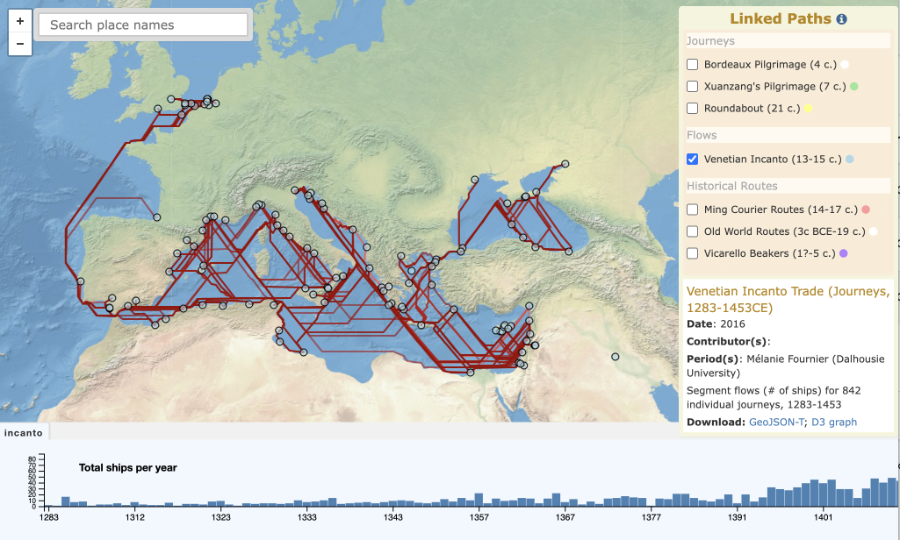
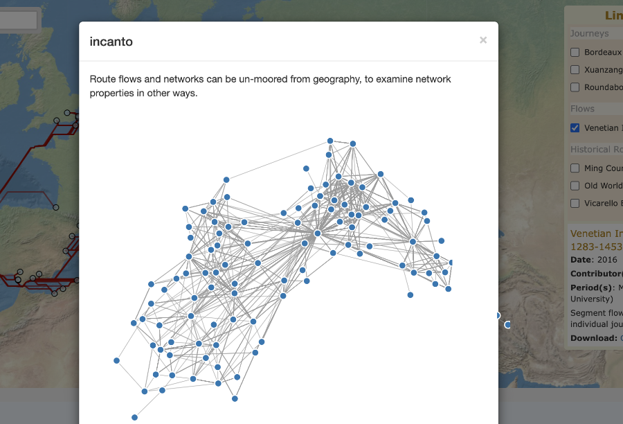

Title: Linked Paths
Date: 2017-02-10
Category: Projects
Status: published
Template: page
Slug: linked-paths

## Screenshots

  <figure>
    
    <figcaption>Map view</figcaption>
  </figure>
  <figure>
    
    <figcaption>Network graph view</figcaption>
  </figure>

---

## Platform
<a href="http://linkedpaths.kgeographer.org" target="_blank">Linked Paths</a>

<a href="https://github.com/kgeographer/linked-paths" target="_blank">GitHub repository</a>

## Organization
KGEO Research (that's me) — personal research prototype

## Roles
Creator; Sole Developer

## Technologies
Mapbox.js (Leaflet); D3.js (timeline, histogram, force-directed graph); Elasticsearch + Typeahead/Bloodhound; Bootstrap; jQuery; Handlebars; Grunt/Browserify/Babel; Python (data build); GeoJSON-T

---

## Description

**Linked Paths** is a personal research prototype, built in 2017–18, for visualizing and analyzing historical geographic movement. It was designed specifically to test and demonstrate **GeoJSON-T**, an experimental extension to GeoJSON I was developing for representing temporal movement data and the records of historical gazetteers — the same format that went on to mature into the **Linked Places Format (LPF)**, now the core data model of the World Historical Gazetteer.

The application organizes historical datasets into three distinct categories of movement: **journeys** (individual travel, such as the 4th-century Bordeaux Pilgrim and Xuanzang's 7th-century pilgrimage to India), **flows** (repeated movement between nodes, such as the Venetian Incanto galley trade of 1283–1453), and **historical routes** (named route systems, including the Ming Courier Routes and Old World Trade Routes). Each dataset type drives its own tailored timeline — an event timeline, a period timeline, or a histogram — built with D3.js alongside a Mapbox/Leaflet map, with place search powered by a local Elasticsearch index.

GeoJSON-T's structure means a flow or network's relations can be read independent of its geography — a connection graph of what links to what, not just a map of where. The app demonstrates this directly: pick a flow dataset, such as the Venetian Incanto trade, and it renders as a force-directed graph, detached entirely from the map. For a solo side project built with 2017-era tooling (Grunt, Browserify, Mapbox.js v3), it previewed analytical capabilities that wouldn't become standard in historical GIS tools for years afterward.
